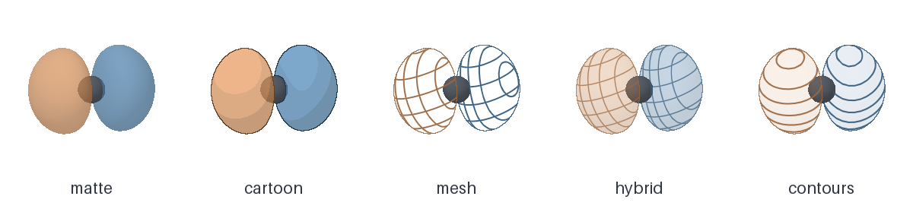

# Orbital Ink

[中文使用说明](使用说明.md)

Render the positive and negative lobes of a molecular orbital from a single-field Gaussian Cube. Choose a matte surface, cartoon shading, open mesh, tinted mesh or parallel contours. Pick a phase palette, rotate the view and export a white-background PNG or lossless TIFF.

## Install

From a copy of this repository, with Python 3.10 or later:

~~~shell
python -m pip install .
orbital-ink gui
~~~

In the window, choose **Try example** or **Open Cube**, select an isovalue and click **Render**. Use **Save image** to export what you previewed. The GUI requires a Python installation with Tk. The command-line renderer needs only NumPy and Pillow.

## Command line

~~~shell
orbital-ink demo demo.cube
orbital-ink render demo.cube figure.png --iso 0.08 --style cartoon --palette blue-orange
orbital-ink render demo.cube figure.tiff --iso 0.08 --style mesh --yaw 25 --pitch 15 --width 1200
~~~

The five styles are `matte`, `cartoon`, `mesh`, `hybrid` and `contours`. Palettes are `sage`, `blue-orange`, `indigo-rose`, `teal-wheat` and `graphite`. In the blue-orange palette, blue represents positive amplitude. Output is a square RGB image at the specified pixel width, tagged at 450 dpi. TIFF uses LZW compression. Existing image outputs are replaced on successful export.

## Input and rendering

Supply a signed scalar field with one orbital per Cube. The reader supports a single orbital identifier in a negative-atom-count Cube. Positive grid counts use bohr. Consistently negative grid counts use the angstrom convention. Bond sticks are inferred from distances and covalent radii. Materials and element colors are illustrative.

The isovalue specifies the two surfaces at +c and −c in the field's own units. Use the same isovalue and orientation when comparing orbitals. Default axes follow the Cube world coordinates. Each input is automatically framed. Rotation and nonstandard grid axes use trilinear resampling onto an orthographic display grid, limited to about 230 steps across the longest dimension. The renderer finds the front surface for each phase along each ray. Mesh and contour lines follow plane intersections on these surfaces.

## Development

~~~shell
python -m unittest discover -s tests
~~~

The example uses an analytic p-shaped field generated locally. The package performs no electronic-structure calculation.

